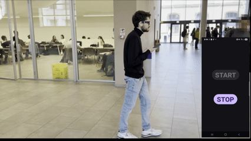

<h1 align="center"> Hello there 👋</h1>

### I'm Michele Perseo (you can call me Mick) and I'm a **Computer vision software engineer**
I have been Building perception systems for robots and assistive technology: from LiDAR/camera pipelines on a Formula Student driverless car to real-time detection on smart glasses up to making a dron eland through ArUco markers detection..

✨ Dreaming of changing the assistive technology world  ✨

## Featured projects
### 🕶️ Indoor navigation for smart glasses (MSc thesis)

Meta Project Aria + Android app: real-time object detection (YOLOv11, TFLite) that guides the wearer to a target room. **mAP@0.5 0.93 · ~150 ms end-to-end on-device.**
[Repo](https://github.com/michelexseo/project-aria-indoor-navigation) · [Video](https://www.youtube.com/watch?v=VixqrmUZ1rQ) · [Thesis](https://webthesis.biblio.polito.it/39925/1/tesi.pdf)

### 🛬 ArUco precision landing for PX4
Python + OpenCV vision pipeline on a companion computer for autonomous precision landing.
[Repo](https://github.com/michelexseo/ArUco-precision-landing): **pose estimation accuracy: 0.2 cm**

## Experience highlights
- Led the Computer Vision & Perception division at Squadra Corse Driverless: LiDAR + RGB perception, ROS 2, sensor fusion. KD-Tree DBSCAN in C++ cut latency by 50%.
- Developed a precision landing algorithm for a PX4 based flight controller, using MAVlink route, openCV and a raspberry pi.

## Stack

## Contact
[LinkedIn](https://www.linkedin.com/in/michele-perseo-59b180268) · miperseo@gmail.com